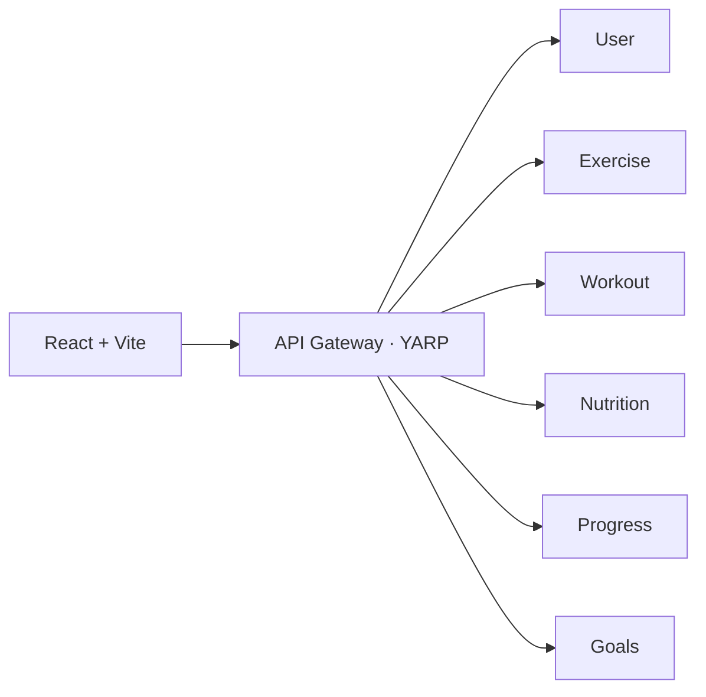

# FitTrack

FitTrack je študentski projekt pri predmetu SUA. Spletna aplikacija povezuje načrtovanje treningov, dnevnik prehrane, telesne meritve in spremljanje osebnih ciljev.

[Kanban](https://github.com/users/delimanchev/projects/6/views/2) · [GitHub Issues](https://github.com/delimanchev/FitTrack/issues) · [Načrt in pogoji za Nalogo 2](docs/naloga-2.md)

## Kaj omogoča FitTrack

- Uporabniški račun, prijava in urejanje profila.
- Iskanje vaj po katalogu ter sestavljanje, zaključevanje in pregled treningov.
- Dnevnik obrokov s podatki o kalorijah in makrohranilih.
- Beleženje telesne teže in obsegov ter spremljanje njihove zgodovine.
- Spremljanje napredka pri ciljni teži in tedenskem številu treningov.

## Arhitektura in ekipa

React + Vite frontend kliče REST API prek gatewaya YARP. Vsaka mikrostoritev upravlja svojo bazo PostgreSQL in svoje migracije. Storitve, ki potrebujejo podatke druge storitve, uporabijo interni REST API v omrežju Docker Compose.



| Mikrostoritev | Kaj upravlja | Odgovorna oseba | Ogrodje | Baza PostgreSQL | Issue |
| --- | --- | --- | --- | --- | --- |
| User | Račune, prijavo, JWT in uporabniške nastavitve | Andrej Delimanchev (`@delimanchev`) | ASP.NET Core Web API | `user_db` | [#3](https://github.com/delimanchev/FitTrack/issues/3) |
| Exercise | Katalog vaj in mišičnih skupin | Andrej | ASP.NET Core Web API | `exercise_db` | [#5](https://github.com/delimanchev/FitTrack/issues/5) |
| Workout | Načrtovanje, izvedbo in zgodovino treningov | Andrej | ASP.NET Core Web API | `workout_db` | [#4](https://github.com/delimanchev/FitTrack/issues/4) |
| Nutrition | Obroke, sestavine, kalorije in makrohranila | Anastasija Todorov (`@AnjaTodorov`) | FastAPI | `nutrition_db` | [#7](https://github.com/delimanchev/FitTrack/issues/7) |
| Progress | Telesno težo, obsege in zgodovino meritev | Anastasija | NestJS | `progress_db` | [#6](https://github.com/delimanchev/FitTrack/issues/6) |
| Goals | Osebne cilje, nastavitve opomnikov in izračun napredka | Anastasija | FastAPI | `goals_db` | [#8](https://github.com/delimanchev/FitTrack/issues/8) |

## Lokalni razvoj

Trenutno je v repozitoriju pripravljena osnova [User Service](services/user). Postavitev celotnega sistema je v razvoju. Spodnji ukaz zažene obstoječi User Service z lokalnim .NET 10 SDK.

```powershell
git clone https://github.com/delimanchev/FitTrack.git
cd FitTrack
dotnet run --project services/user/FitTrack.UserService.csproj --launch-profile http
```

Obstoječi razvojni profil uporablja `http://localhost:5297`. Vzorčno zahtevo najdeš v datoteki [FitTrack.UserService.http](services/user/FitTrack.UserService.http). Swagger UI je na `http://localhost:5297/swagger`.

Za razvoj zunaj Dockerja zaledje uporablja še Python za FastAPI in Node.js z npm za NestJS. Node.js potrebuje tudi frontend. Za skupni lokalni zagon potrebujemo Docker Compose.

### Predvideni zagon celotnega sistema

Ko sta [`compose.yaml`](compose.yaml) in `.env.example` pripravljena, kopiramo `.env.example` v `.env` in nastavimo lokalne povezave do baz, vrata in poverilnice. Lokalne vrednosti ostanejo v `.env`.

```powershell
Copy-Item .env.example .env
docker compose config --quiet
docker compose up --build -d
docker compose ps
docker compose down
```

Predvideni lokalni vstopni točki sta frontend (`http://localhost:5173`) in API Gateway (`http://localhost:8080`). Posamezna mikrostoritev objavi svoj `/openapi.json` na internem naslovu v omrežju Compose.

## REST API

Frontend kliče poti `/api/*` prek gatewaya. V tabeli so poti za gateway in mikrostoritev enake. Tabela povzema osnovne operacije posamezne storitve. `{id}` označuje identifikator glavnega vira ustrezne storitve.

| Storitev | GET × 2 | POST × 2 | PUT × 2 | DELETE × 2 |
| --- | --- | --- | --- | --- |
| User | `/api/users/me`<br>`/api/users/me/preferences` | `/api/auth/register`<br>`/api/auth/login` | `/api/users/me`<br>`/api/users/me/preferences` | `/api/users/me`<br>`/api/users/me/preferences` |
| Exercise | `/api/exercises`<br>`/api/exercises/{id}` | `/api/exercises`<br>`/api/muscle-groups` | `/api/exercises/{id}`<br>`/api/muscle-groups/{groupId}` | `/api/exercises/{id}`<br>`/api/muscle-groups/{groupId}` |
| Workout | `/api/workouts`<br>`/api/workouts/{id}` | `/api/workouts`<br>`/api/workouts/{id}/exercises` | `/api/workouts/{id}`<br>`/api/workouts/{id}/exercises/{itemId}` | `/api/workouts/{id}`<br>`/api/workouts/{id}/exercises/{itemId}` |
| Nutrition | `/api/meals?date=…`<br>`/api/meals/{id}` | `/api/meals`<br>`/api/meals/{id}/items` | `/api/meals/{id}`<br>`/api/meals/{id}/items/{itemId}` | `/api/meals/{id}`<br>`/api/meals/{id}/items/{itemId}` |
| Progress | `/api/progress`<br>`/api/progress/latest` | `/api/progress`<br>`/api/progress/body-measurements` | `/api/progress/{id}`<br>`/api/progress/body-measurements/{measurementId}` | `/api/progress/{id}`<br>`/api/progress/body-measurements/{measurementId}` |
| Goals | `/api/goals`<br>`/api/goals/{id}/status` | `/api/goals`<br>`/api/goals/{id}/reminders` | `/api/goals/{id}`<br>`/api/goals/{id}/reminders/{reminderId}` | `/api/goals/{id}`<br>`/api/goals/{id}/reminders/{reminderId}` |

- `PUT` zamenja celoten zapis. `PATCH /api/users/me`, `PATCH /api/workouts/{id}`, `PATCH /api/meals/{id}` in `PATCH /api/goals/{id}` omogočajo delne spremembe. Prek `PATCH /api/workouts/{id}` se trening tudi zaključi.
- Za pregled dodatnih virov sta predvideni poti `GET /api/muscle-groups` in `GET /api/progress/body-measurements`. Podrobnosti treninga oziroma obroka vrnejo tudi postavke. Seznam ciljev vsebuje nastavitve opomnikov. Cilji hranijo nastavitve opomnikov v lastni bazi.
- Izbris uporabniških nastavitev ponastavi profil na privzete nastavitve. Izbris zapisa z lastnimi podrejenimi postavkami odstrani tudi te postavke v isti transakciji. Izbris mišične skupine, ki jo uporablja vaja, vrne `409`.
- Predvideni odgovori so `201` pri ustvarjanju, `200` za branje, prijavo in posodobitve ter `204` ob uspešnem brisanju. Napake uporabljajo `400` za neveljavne podatke, `401` za manjkajočo ali neveljavno prijavo, `403` za nedovoljen dostop, `404` za manjkajoč vir, `409` za konflikt in `503` za nedosegljivo odvisnost.
- Javna registracija ustvari vlogo `USER`. Za spremembe kataloga je potrebna vloga `ADMIN`. Storitve preverijo podpis, izdajatelja, občinstvo, rok veljavnosti JWT in pravice. Za lastne podatke uporabijo `sub` iz JWT. Testni administrator se v lokalnem okolju pripravi prek okoljske konfiguracije.

### Klici med storitvami

Interni klici uporabljajo imena storitev v omrežju Compose in spodnje poti brez predpone `/api`. Klicatelj pošlje storitveno poverilnico, prejemnik pa preveri identiteto in dovoljenje klicatelja. Pri uporabniških poizvedbah se posreduje tudi podatek o uporabniku, pridobljen iz preverjene identitete uporabnika. Gateway usmerja javne poti, interne obravnave pa berejo lastno bazo brez povratnega klica.

| Klicatelj → prejemnik | Interna zahteva | Kdaj se izvede |
| --- | --- | --- |
| Workout → Exercise | `GET /exercises/{exerciseId}` | Pri dodajanju ali zamenjavi vaje v treningu |
| Nutrition → User | `GET /users/{userId}` | Pri vnosu obroka |
| Progress → User | `GET /users/{userId}` | Pri vnosu meritve |
| Goals → Progress | `GET /progress/latest` | Pri izračunu napredka proti ciljni teži |
| Goals → Workout | `GET /workouts/completed?from=…&to=…` | Pri izračunu tedenskega števila zaključenih treningov |
| User → Nutrition | `GET /meals/summary?date=…` | `GET /api/users/me/overview` prikaže število današnjih obrokov |
| Exercise → Progress | `GET /progress/latest` | `GET /api/exercises/{id}/energy-estimate?minutes=…` oceni porabo energije glede na MET, trajanje in težo |
| Workout → Progress | `GET /progress/latest` | Ob zaključku treninga se shrani zadnja teža, če obstaja |

HTTP klici imajo časovno omejitev. Če meritev teže še ne obstaja, Workout lahko zaključi trening brez teže, Goals prikaže status brez podatka o teži, Exercise pa za oceno porabe vrne `404`. Ob nedosegljivi nujni odvisnosti storitev vrne `503` in prepreči delni zapis.

## Potek dela

1. Pred spremembo preverimo posodobitve na `main` in ustvarimo vejo iz zadnje različice. Povezano nalogo v Kanbanu premaknemo v **In Progress**.
2. Spremembo lokalno preizkusimo, potisnemo vejo in odpremo pull request. Če PR zaključi issue, ga povežemo z `Closes #<številka>`.
3. Po pregledu in združitvi zaključeno nalogo premaknemo v **Done**.

Načrt, kriteriji in demonstracija trenutne projektne naloge so v [vodniku za Nalogo 2](docs/naloga-2.md).
